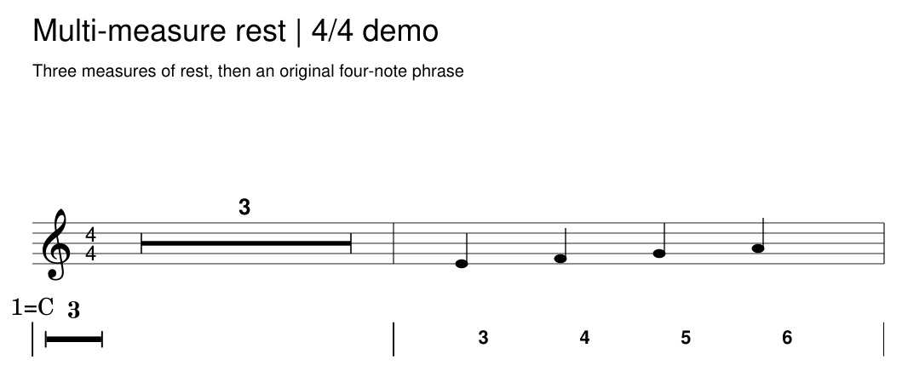

# v1.1.0 · 多小节休止与原谱对齐

发布日期：2026-11-24

上一个版本：[v1.0.0 · macOS 硬件加速与低内存适配](../../CHANGELOG.md)

## 本版改动

- **识别后处理**：用矢量 PDF 上的谱行、小节边界、H 形休止符和数字核对 MusicXML。对应关系唯一时，在派生文件补回漏掉的休止格，填充已有空格，或把一串休止合成一个印刷格。原始文件保留，冲突和无法唯一定位的候选写入 `*.pdf-multirests.json`。显式输入的既有 MusicXML 如与原谱计数冲突，保留原计数供校对。
- **原谱结构**：合并 Homr 的逐页结果时，显式保留换页与已有换行。单页旧式折叠遇到对齐歧义时，保留识谱结果并继续转换。
- **简谱与 MIDI**：整页、原位和校对文本支持原生带数字长休止。已有标准 MusicXML 中连续编码的全小节休止可合成一个简谱符号。MIDI 对已确认的长休止按实际小节数留出静音。
- **适用范围**：继续使用 Homr／Audiveris。长休止的原图核对依赖矢量 PDF 和可靠的页、谱行对应。扫描件的长休止数字识别尚无专项验证。

## 测试结果

- 自动测试共 259 项，218 项通过，41 项按原有条件跳过，0 项失败。
- 曲笛、二胡、笙、两份《秦兵马俑》分谱及扫描二胡共六份本地样本成功导出。五份矢量分谱的原位谱行均成功生成，二胡原有的一处小节对齐疑点保留。
- 重新识别《秦兵马俑》长笛兼埙原谱第 2 页，恢复漏掉的 **10 小节休止**，另有两处计数按原谱订正为 **13** 和 **2**。原位谱 8/8 行生成，小节对齐疑点为 0，另外一处音乐内容冲突保留待校对。核对确认 MIDI 首次发音在 41 个四分音符拍之后。
- 重新识别笙谱首页，确认 **35** 和 **14** 小节休止，8/8 行生成，另外 3 处小节对齐疑点保留。

## 原创样片



[原始五线谱](samples/v1.1.0/multirest-source.pdf) · [缺失长休止的输入 MusicXML](samples/v1.1.0/multirest-missing.musicxml) · [原位简谱 PDF](samples/v1.1.0/multirest-output.pdf)

例谱在 4/4 中先休止 3 小节，再进入四个四分音符。用以下命令从仓库根目录复现，需已配置 Python 和 LilyPond：

```bash
python3 jianpu.py docs/releases/samples/v1.1.0/multirest-source.pdf \
  --mxl docs/releases/samples/v1.1.0/multirest-missing.musicxml \
  --mode both --strict --pitch-mode fixed -o output/multirest-demo --midi output/multirest-demo.mid
```

预期结果为 1/1 谱行生成、0 处对齐疑点，原位谱的第一格标注 3，MIDI 首次发音在 12 拍后。

## 研究参考

本版参考中央音乐学院与清华大学研究团队的 Congren Dai、Zhancheng Guo、Xiaobing Li、Maosong Sun，[*Cecilia: Towards Layout-Inclusive Optical Music Recognition*](https://arxiv.org/abs/2611.27465)，arXiv:2611.27465（2026）。论文关于保留小节结构、原谱分行和分页的设计启发了本版的布局核对与后处理。
